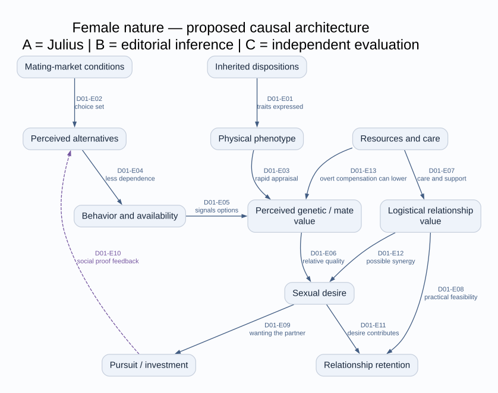
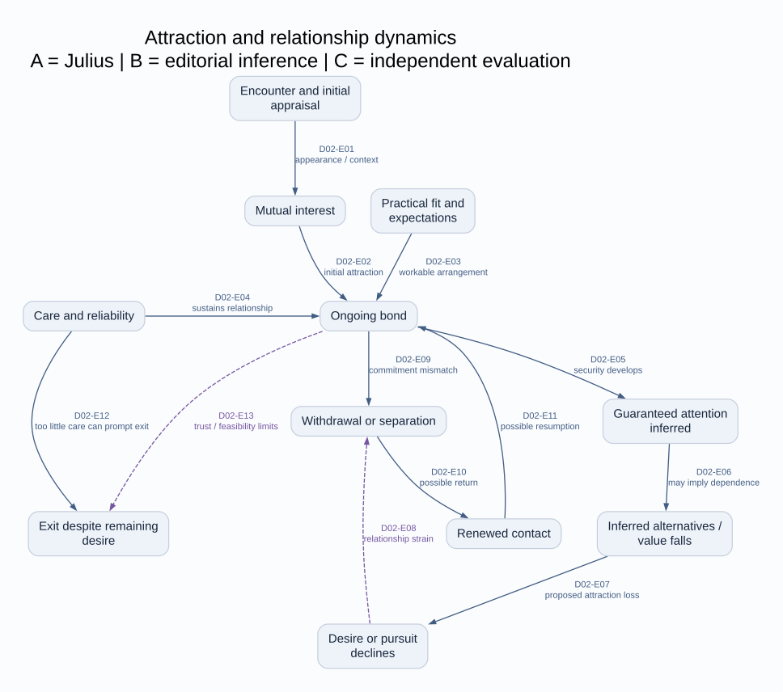
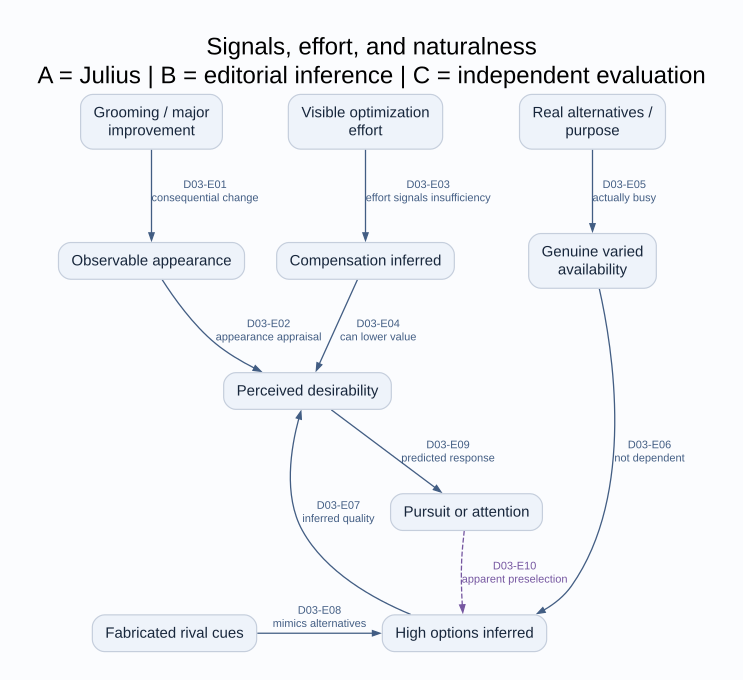
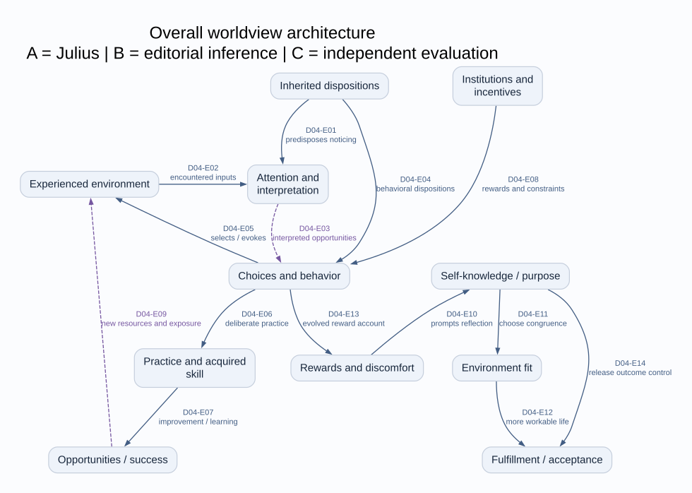
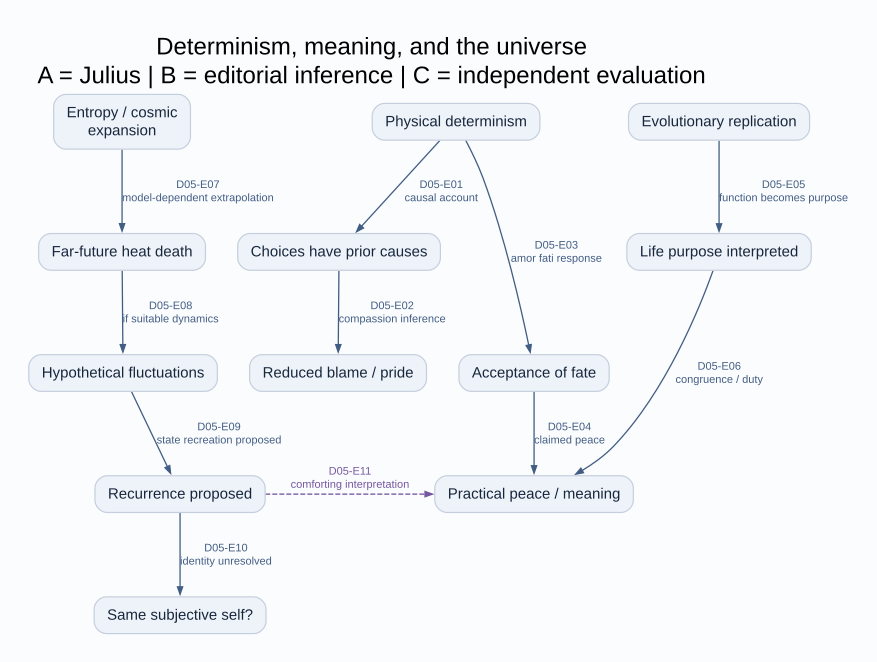
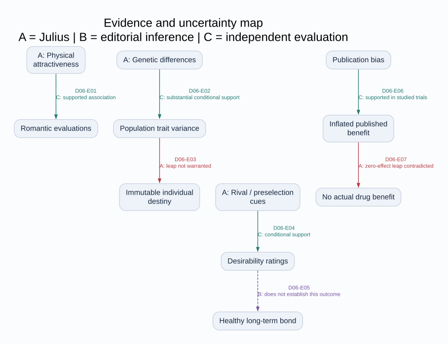
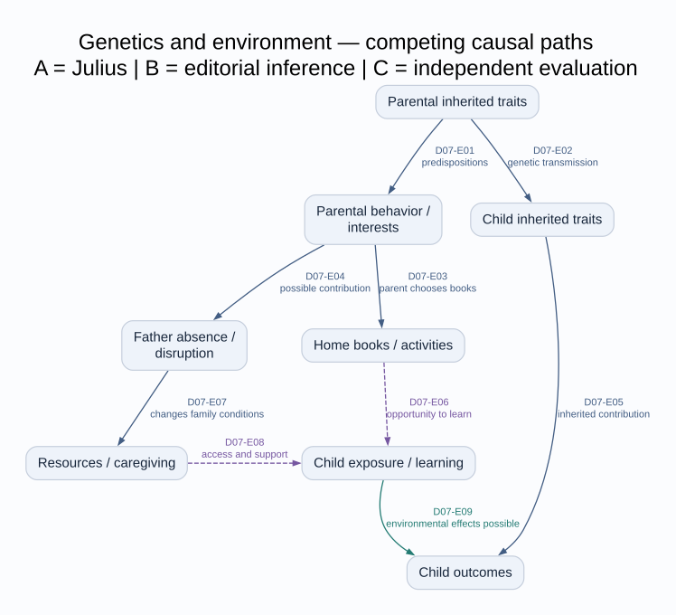

# Diagrams and edge-by-edge provenance

[Atlas entrance](../START_HERE.md) · [Female model](../FEMALE_NATURE/Complete_Model.md) · [Science review](../SCIENCE/Scientific_Evidence_Review.md)

**How to read.** A = Julius’s assertion, recommendation, or self-report; B = editorial interpretation/inferred connection; C = independent scientific evaluation. An arrow reports a proposed causal or conceptual dependency, not a measured effect. Dashed violet arrows are inferred connections. Teal edges indicate conditional scientific support; red edges identify an invalid/contradicted inference. Text labels and the ledger carry the meaning as well as color.

**Formats.** Each figure has editable Mermaid (`.mmd`) and rendered SVG (`.svg`). SVGs use an equivalent Graphviz layout of the same node/edge list, not a Mermaid screenshot; edge IDs match exactly. The images are standalone and zoomable. Automatic layouts can differ in Mermaid viewers; the edge ledgers are authoritative. PNG previews are also included for viewers without SVG support.

**Interpretation limits.** There are no fitted weights, quantified thresholds, diagnostic categories, or proven universal laws in these drawings. Relationships with multiple explanations remain conditional. D06 is an independent evidence comparison; D07 is an explicitly illustrative competing-path model.

## Figure index

| Figure | Topic | Files |
|---|---|---|
| D01 | Female nature — proposed causal architecture | [SVG](d01_female_causal_architecture.svg) · [PNG](d01_female_causal_architecture.png) · [Mermaid](d01_female_causal_architecture.mmd) |

## D01. Female nature — proposed causal architecture

A reconstruction of Julius’s proposed pathways. It separates erotic attraction, practical relationship value, and observed pursuit or retention. A feedback arrow is a claim about perceived alternatives, not proof of a genetic measurement. None of the numerical weights is estimated.

| Edge | Proposed link | Status | Traceability |
|---|---|---|---|
| D01-E01 | Inherited dispositions → Physical phenotype: traits expressed | A: asserted | [V003 · 2022-06-05 · 01:35](https://www.youtube.com/watch?v=E7rekEt5whE&t=95s) [V020 · 2022-09-17 · 00:00](https://www.youtube.com/watch?v=Oz7CwcUmzDM&t=0s) |
| D01-E02 | Mating-market conditions → Perceived alternatives: choice set | A: asserted | [V003 · 2022-06-05 · 15:48](https://www.youtube.com/watch?v=E7rekEt5whE&t=948s) [V153 · 2026-06-09 · 00:00](https://www.youtube.com/watch?v=h7pQTjJ3OKQ&t=0s) |
| D01-E03 | Physical phenotype → Perceived genetic / mate value: rapid appraisal | A: asserted | [V003 · 2022-06-05 · 01:35](https://www.youtube.com/watch?v=E7rekEt5whE&t=95s) |
| D01-E04 | Perceived alternatives → Behavior and availability: less dependence | A: asserted | [V192 · 2026-09-09 · 07:13](https://www.youtube.com/watch?v=jKPLlSN46Bc&t=433s) |
| D01-E05 | Behavior and availability → Perceived genetic / mate value: signals options | A: asserted | [V145 · 2026-05-31 · 00:00](https://www.youtube.com/watch?v=G6eh83P6Rf4&t=0s) [V192 · 2026-09-09 · 03:38](https://www.youtube.com/watch?v=jKPLlSN46Bc&t=218s) |
| D01-E06 | Perceived genetic / mate value → Sexual desire: relative quality | A: asserted | [V104 · 2026-05-07 · 00:00](https://www.youtube.com/watch?v=ij3aM-RTNdw&t=0s) |
| D01-E07 | Resources and care → Logistical relationship value: care and support | A: asserted | [V190 · 2026-08-23 · 03:38](https://www.youtube.com/watch?v=Jq6SD2UkJFs&t=218s) |
| D01-E08 | Logistical relationship value → Relationship retention: practical feasibility | A: asserted | [V190 · 2026-08-23 · 01:41](https://www.youtube.com/watch?v=Jq6SD2UkJFs&t=101s) |
| D01-E09 | Sexual desire → Pursuit / investment: wanting the partner | A: asserted | [V083 · 2026-04-10 · 00:00](https://www.youtube.com/watch?v=G2YXmz68BHM&t=0s) |
| D01-E10 | Pursuit / investment → Perceived alternatives: social proof feedback | B: inferred connection | [V074 · 2025-05-08 · 00:00](https://www.youtube.com/watch?v=Vol8SIdq9mE&t=0s) [V192 · 2026-09-09 · 03:38](https://www.youtube.com/watch?v=jKPLlSN46Bc&t=218s); combines attraction and information steps |
| D01-E11 | Sexual desire → Relationship retention: desire contributes | A: asserted, conditional | [V190 · 2026-08-23 · 01:41](https://www.youtube.com/watch?v=Jq6SD2UkJFs&t=101s) |
| D01-E12 | Logistical relationship value → Sexual desire: possible synergy | A: asserted, conditional | [V190 · 2026-08-23 · 03:38](https://www.youtube.com/watch?v=Jq6SD2UkJFs&t=218s) |
| D01-E13 | Resources and care → Perceived genetic / mate value: overt compensation can lower | A: asserted, conditional | [V190 · 2026-08-23 · 07:27](https://www.youtube.com/watch?v=Jq6SD2UkJFs&t=447s) |
| D02 | Attraction and relationship dynamics | [SVG](d02_attraction_relationship_stages.svg) · [PNG](d02_attraction_relationship_stages.png) · [Mermaid](d02_attraction_relationship_stages.mmd) |

## D02. Attraction and relationship dynamics

A stage-sensitive reconstruction. Progress is conditional, not an inevitable pipeline. Desire can persist after a breakup; a partner can leave because care or trust is inadequate. Returning does not independently demonstrate improved welfare.

| Edge | Proposed link | Status | Traceability |
|---|---|---|---|
| D02-E01 | Encounter and initial appraisal → Mutual interest: appearance / context | A: asserted | [V003 · 2022-06-05 · 01:35](https://www.youtube.com/watch?v=E7rekEt5whE&t=95s) [V104 · 2026-05-07 · 00:00](https://www.youtube.com/watch?v=ij3aM-RTNdw&t=0s) |
| D02-E02 | Mutual interest → Ongoing bond: initial attraction | A: asserted | [V083 · 2026-04-10 · 00:00](https://www.youtube.com/watch?v=G2YXmz68BHM&t=0s) |
| D02-E03 | Practical fit and expectations → Ongoing bond: workable arrangement | A: asserted | [V190 · 2026-08-23 · 01:41](https://www.youtube.com/watch?v=Jq6SD2UkJFs&t=101s) |
| D02-E04 | Care and reliability → Ongoing bond: sustains relationship | A: asserted | [V127 · 2026-05-19 · 29:13](https://www.youtube.com/watch?v=C9jRj0Lx69I&t=1753s) [V190 · 2026-08-23 · 03:38](https://www.youtube.com/watch?v=Jq6SD2UkJFs&t=218s) |
| D02-E05 | Ongoing bond → Guaranteed attention inferred: security develops | A: asserted | [V083 · 2026-04-10 · 01:38](https://www.youtube.com/watch?v=G2YXmz68BHM&t=98s) |
| D02-E06 | Guaranteed attention inferred → Inferred alternatives / value falls: may imply dependence | A: asserted, contested | [V083 · 2026-04-10 · 01:38](https://www.youtube.com/watch?v=G2YXmz68BHM&t=98s) |
| D02-E07 | Inferred alternatives / value falls → Desire or pursuit declines: proposed attraction loss | A: asserted, contested | [V083 · 2026-04-10 · 03:27](https://www.youtube.com/watch?v=G2YXmz68BHM&t=207s) |
| D02-E08 | Desire or pursuit declines → Withdrawal or separation: relationship strain | B: inferred connection | [V083 · 2026-04-10 · 00:00](https://www.youtube.com/watch?v=G2YXmz68BHM&t=0s) [V136 · 2026-05-27 · 30:55](https://www.youtube.com/watch?v=n8qUXvXAKfI&t=1855s); connects desire and exit rather than claiming all exits share one cause |
| D02-E09 | Ongoing bond → Withdrawal or separation: commitment mismatch | A: self-reported interpretation | [V103 · 2026-05-06 · 00:00](https://www.youtube.com/watch?v=kyYnmxO9yBY&t=0s) [V122 · 2026-05-16 · 00:00](https://www.youtube.com/watch?v=NYnpEeDjd1A&t=0s) |
| D02-E10 | Withdrawal or separation → Renewed contact: possible return | A: self-reported outcome | [V145 · 2026-05-31 · 00:00](https://www.youtube.com/watch?v=G6eh83P6Rf4&t=0s) [V127 · 2026-05-19 · 36:36](https://www.youtube.com/watch?v=C9jRj0Lx69I&t=2196s) |
| D02-E11 | Renewed contact → Ongoing bond: possible resumption | A: self-reported outcome | [V145 · 2026-05-31 · 00:00](https://www.youtube.com/watch?v=G6eh83P6Rf4&t=0s) |
| D02-E12 | Care and reliability → Exit despite remaining desire: too little care can prompt exit | A: asserted, conditional | [V127 · 2026-05-19 · 29:13](https://www.youtube.com/watch?v=C9jRj0Lx69I&t=1753s) |
| D02-E13 | Ongoing bond → Exit despite remaining desire: trust / feasibility limits | B: inferred connection | [V184 · 2026-07-29 · 00:00](https://www.youtube.com/watch?v=CwJyhhm8y9I&t=0s) [V186 · 2026-07-30 · 00:00](https://www.youtube.com/watch?v=NJdfhaeQ7UE&t=0s); competing explanation for departures, not a verified partner motive |
| D03 | Signals, effort, and naturalness | [SVG](d03_signals_effort_and_naturalness.svg) · [PNG](d03_signals_effort_and_naturalness.png) · [Mermaid](d03_signals_effort_and_naturalness.mmd) |

## D03. Signals, effort, and naturalness

The proposed signaling account explains why he can favor both self-improvement and stopping optimization. Actual improvement and the inferred cost of visible compensation are different paths. Ethical assessment of deception is separate from his claimed signal.

| Edge | Proposed link | Status | Traceability |
|---|---|---|---|
| D03-E01 | Grooming / major improvement → Observable appearance: consequential change | A: asserted | [V082 · 2026-04-09 · 00:00](https://www.youtube.com/watch?v=L8b_6ycWCmc&t=0s) [V160 · 2026-06-21 · 00:00](https://www.youtube.com/watch?v=qpH6eR6SapA&t=0s) |
| D03-E02 | Observable appearance → Perceived desirability: appearance appraisal | A: asserted | [V003 · 2022-06-05 · 01:35](https://www.youtube.com/watch?v=E7rekEt5whE&t=95s) |
| D03-E03 | Visible optimization effort → Compensation inferred: effort signals insufficiency | A: asserted, unverified generalization | [V193 · 2026-09-12 · 00:00](https://www.youtube.com/watch?v=xRL2EA6u1qM&t=0s) [V193 · 2026-09-12 · 11:04](https://www.youtube.com/watch?v=xRL2EA6u1qM&t=664s) |
| D03-E04 | Compensation inferred → Perceived desirability: can lower value | A: asserted | [V190 · 2026-08-23 · 07:27](https://www.youtube.com/watch?v=Jq6SD2UkJFs&t=447s) [V193 · 2026-09-12 · 13:00](https://www.youtube.com/watch?v=xRL2EA6u1qM&t=780s) |
| D03-E05 | Real alternatives / purpose → Genuine varied availability: actually busy | A: asserted | [V192 · 2026-09-09 · 07:13](https://www.youtube.com/watch?v=jKPLlSN46Bc&t=433s) [V192 · 2026-09-09 · 17:06](https://www.youtube.com/watch?v=jKPLlSN46Bc&t=1026s) |
| D03-E06 | Genuine varied availability → High options inferred: not dependent | A: asserted | [V192 · 2026-09-09 · 03:38](https://www.youtube.com/watch?v=jKPLlSN46Bc&t=218s) |
| D03-E07 | High options inferred → Perceived desirability: inferred quality | A: asserted | [V145 · 2026-05-31 · 00:00](https://www.youtube.com/watch?v=G6eh83P6Rf4&t=0s) |
| D03-E08 | Fabricated rival cues → High options inferred: mimics alternatives | A: recommended tactic; efficacy unverified | [V083 · 2026-04-10 · 09:10](https://www.youtube.com/watch?v=G2YXmz68BHM&t=550s) [V192 · 2026-09-09 · 19:00](https://www.youtube.com/watch?v=jKPLlSN46Bc&t=1140s) |
| D03-E09 | Perceived desirability → Pursuit or attention: predicted response | A: asserted | [V074 · 2025-05-08 · 00:00](https://www.youtube.com/watch?v=Vol8SIdq9mE&t=0s) |
| D03-E10 | Pursuit or attention → High options inferred: apparent preselection | B: inferred connection | [V074 · 2025-05-08 · 00:00](https://www.youtube.com/watch?v=Vol8SIdq9mE&t=0s); attention can become a further signal in the reconstructed loop |
| D04 | Overall worldview architecture | [SVG](d04_overall_worldview.svg) · [PNG](d04_overall_worldview.png) · [Mermaid](d04_overall_worldview.mmd) |

## D04. Overall worldview architecture

The broad explanatory system, including reciprocal gene–environment selection and practical learning. Solid edges report Julius; dashed edges are editorial connections. Presence in the diagram does not certify a pathway’s size or genetic exclusivity.

| Edge | Proposed link | Status | Traceability |
|---|---|---|---|
| D04-E01 | Inherited dispositions → Attention and interpretation: predisposes noticing | A: asserted | [V147 · 2026-06-01 · 00:00](https://www.youtube.com/watch?v=eZHlruluYDI&t=0s) [V201 · 2026-10-24 · 03:49](https://www.youtube.com/watch?v=Vh7KSCqtCaI&t=229s) |
| D04-E02 | Experienced environment → Attention and interpretation: encountered inputs | A: asserted, sometimes minimized | [V023 · 2022-10-19 · 00:00](https://www.youtube.com/watch?v=2h9nkqaymwg&t=0s) [V201 · 2026-10-24 · 00:00](https://www.youtube.com/watch?v=Vh7KSCqtCaI&t=0s) |
| D04-E03 | Attention and interpretation → Choices and behavior: interpreted opportunities | B: inferred connection | [V121 · 2026-05-15 · 00:00](https://www.youtube.com/watch?v=YON5gVBNVDQ&t=0s) [V149 · 2026-06-03 · 00:01](https://www.youtube.com/watch?v=8kEcZI7Ph6c&t=1s) |
| D04-E04 | Inherited dispositions → Choices and behavior: behavioral dispositions | A: asserted | [V020 · 2022-09-17 · 00:00](https://www.youtube.com/watch?v=Oz7CwcUmzDM&t=0s) |
| D04-E05 | Choices and behavior → Experienced environment: selects / evokes | A: asserted | [V147 · 2026-06-01 · 00:00](https://www.youtube.com/watch?v=eZHlruluYDI&t=0s) [V201 · 2026-10-24 · 07:32](https://www.youtube.com/watch?v=Vh7KSCqtCaI&t=452s) |
| D04-E06 | Choices and behavior → Practice and acquired skill: deliberate practice | A: self-reported mechanism | [V070 · 2024-07-14 · 21:28](https://www.youtube.com/watch?v=d-ozlIxnJK8&t=1288s) [V085 · 2026-04-15 · 09:34](https://www.youtube.com/watch?v=8NpNlHQTNbI&t=574s) |
| D04-E07 | Practice and acquired skill → Opportunities / success: improvement / learning | A: self-reported mechanism | [V070 · 2024-07-14 · 19:43](https://www.youtube.com/watch?v=d-ozlIxnJK8&t=1183s) [V070 · 2024-07-14 · 23:17](https://www.youtube.com/watch?v=d-ozlIxnJK8&t=1397s) |
| D04-E08 | Institutions and incentives → Choices and behavior: rewards and constraints | A: asserted | [V008 · 2022-07-05 · 00:00](https://www.youtube.com/watch?v=A9JF2kBiKlU&t=0s) [V052 · 2023-09-21 · 04:27](https://www.youtube.com/watch?v=yjXVDCs7UZE&t=267s) [V187 · 2026-08-04 · 16:08](https://www.youtube.com/watch?v=sEzWT25cB4w&t=968s) |
| D04-E09 | Opportunities / success → Experienced environment: new resources and exposure | B: inferred connection | [V085 · 2026-04-15 · 04:11](https://www.youtube.com/watch?v=8NpNlHQTNbI&t=251s) [V190 · 2026-08-23 · 24:00](https://www.youtube.com/watch?v=Jq6SD2UkJFs&t=1440s) |
| D04-E10 | Rewards and discomfort → Self-knowledge / purpose: prompts reflection | A: asserted | [V195 · 2026-10-01 · 13:15](https://www.youtube.com/watch?v=SpybKpAQ2F8&t=795s) |
| D04-E11 | Self-knowledge / purpose → Environment fit: choose congruence | A: recommended mechanism | [V149 · 2026-06-03 · 00:01](https://www.youtube.com/watch?v=8kEcZI7Ph6c&t=1s) [V195 · 2026-10-01 · 11:07](https://www.youtube.com/watch?v=SpybKpAQ2F8&t=667s) |
| D04-E12 | Environment fit → Fulfillment / acceptance: more workable life | A: asserted | [V149 · 2026-06-03 · 00:01](https://www.youtube.com/watch?v=8kEcZI7Ph6c&t=1s) [V195 · 2026-10-01 · 08:51](https://www.youtube.com/watch?v=SpybKpAQ2F8&t=531s) |
| D04-E13 | Choices and behavior → Rewards and discomfort: evolved reward account | A: asserted, overgeneralized | [V172 · 2026-07-05 · 00:00](https://www.youtube.com/watch?v=qXpniY_SjVw&t=0s) [V195 · 2026-10-01 · 02:14](https://www.youtube.com/watch?v=SpybKpAQ2F8&t=134s) |
| D04-E14 | Self-knowledge / purpose → Fulfillment / acceptance: release outcome control | A: recommended mechanism | [V194 · 2026-09-14 · 33:05](https://www.youtube.com/watch?v=pNx6vJqGkL4&t=1985s) |
| D05 | Determinism, meaning, and the universe | [SVG](d05_determinism_meaning_universe.svg) · [PNG](d05_determinism_meaning_universe.png) · [Mermaid](d05_determinism_meaning_universe.mmd) |

## D05. Determinism, meaning, and the universe

Three related but logically separate strands: causation and responsibility; evolutionary function and chosen meaning; speculative cosmic recurrence. Connections are conceptual unless labeled as a proposed physical process. No arrow runs from relativity directly to a dating law.

| Edge | Proposed link | Status | Traceability |
|---|---|---|---|
| D05-E01 | Physical determinism → Choices have prior causes: causal account | A: philosophical commitment | [V007 · 2022-06-22 · 00:00](https://www.youtube.com/watch?v=BI0kEbHWHck&t=0s) [V194 · 2026-09-14 · 07:06](https://www.youtube.com/watch?v=pNx6vJqGkL4&t=426s) |
| D05-E02 | Choices have prior causes → Reduced blame / pride: compassion inference | A: normative inference | [V007 · 2022-06-22 · 06:40](https://www.youtube.com/watch?v=BI0kEbHWHck&t=400s) |
| D05-E03 | Physical determinism → Acceptance of fate: amor fati response | A: normative response | [V152 · 2026-06-07 · 27:09](https://www.youtube.com/watch?v=06zrH2fN7Cc&t=1629s) [V194 · 2026-09-14 · 08:53](https://www.youtube.com/watch?v=pNx6vJqGkL4&t=533s) |
| D05-E04 | Acceptance of fate → Practical peace / meaning: claimed peace | A: practical claim | [V194 · 2026-09-14 · 33:05](https://www.youtube.com/watch?v=pNx6vJqGkL4&t=1985s) |
| D05-E05 | Evolutionary replication → Life purpose interpreted: function becomes purpose | A: philosophical interpretation | [V004 · 2022-06-08 · 01:29](https://www.youtube.com/watch?v=dovqFBFGOY4&t=89s) [V175 · 2026-07-08 · 00:01](https://www.youtube.com/watch?v=G9lig2R-gAs&t=1s) |
| D05-E06 | Life purpose interpreted → Practical peace / meaning: congruence / duty | A: asserted practical pathway | [V195 · 2026-10-01 · 08:51](https://www.youtube.com/watch?v=SpybKpAQ2F8&t=531s) |
| D05-E07 | Entropy / cosmic expansion → Far-future heat death: model-dependent extrapolation | A: physical account | [V014 · 2022-08-21 · 00:00](https://www.youtube.com/watch?v=eE37Ns3UCcs&t=0s) [V016 · 2022-08-25 · 00:00](https://www.youtube.com/watch?v=x-bUugTWrQk&t=0s) |
| D05-E08 | Far-future heat death → Hypothetical fluctuations: if suitable dynamics | A: speculative | [V017 · 2022-08-29 · 00:00](https://www.youtube.com/watch?v=bPrDpVOu5Y8&t=0s) |
| D05-E09 | Hypothetical fluctuations → Recurrence proposed: state recreation proposed | A: speculative | [V017 · 2022-08-29 · 00:00](https://www.youtube.com/watch?v=bPrDpVOu5Y8&t=0s) [V032 · 2023-06-22 · 00:00](https://www.youtube.com/watch?v=1AfLmhKxI_A&t=0s) |
| D05-E10 | Recurrence proposed → Same subjective self?: identity unresolved | A: explicit open question | [V017 · 2022-08-29 · 05:07](https://www.youtube.com/watch?v=bPrDpVOu5Y8&t=307s) [V068 · 2024-04-04 · 00:03](https://www.youtube.com/watch?v=3ZuykQMmAfI&t=3s) |
| D05-E11 | Recurrence proposed → Practical peace / meaning: comforting interpretation | B: inferred connection | [V068 · 2024-04-04 · 00:03](https://www.youtube.com/watch?v=3ZuykQMmAfI&t=3s); usefulness of belief is distinct from physical truth |
| D06 | Evidence and uncertainty map | [SVG](d06_evidence_uncertainty_map.svg) · [PNG](d06_evidence_uncertainty_map.png) · [Mermaid](d06_evidence_uncertainty_map.mmd) |

## D06. Evidence and uncertainty map

This map evaluates selected links rather than rating the worldview as a single package. A = Julius claim, B = editorial inferred connection, C = independent assessment. Support for one arrow never licenses the unsupported next arrow. See science sections for designs, confounders, and bibliography.

| Edge | Proposed link | Status | Traceability |
|---|---|---|---|
| D06-E01 | A: Physical attractiveness → Romantic evaluations: C: supported association | C: supported association | Science S01; R01–R02. [V003 · 2022-06-05 · 11:06](https://www.youtube.com/watch?v=E7rekEt5whE&t=666s) |
| D06-E02 | A: Genetic differences → Population trait variance: C: substantial conditional support | C: supported, conditional | Science S09; R19. [V020 · 2022-09-17 · 00:00](https://www.youtube.com/watch?v=Oz7CwcUmzDM&t=0s) |
| D06-E03 | Population trait variance → Immutable individual destiny: A: leap not warranted | C: contradicted inference | Science S09–S11; R19–R24. [V199 · 2026-10-21 · 20:39](https://www.youtube.com/watch?v=VKc6PQpxjAU&t=1239s) |
| D06-E04 | A: Rival / preselection cues → Desirability ratings: C: conditional support | C: conditional, heterogeneous | Science S04; R09. [V074 · 2025-05-08 · 00:00](https://www.youtube.com/watch?v=Vol8SIdq9mE&t=0s) |
| D06-E05 | Desirability ratings → Healthy long-term bond: B: does not establish this outcome | B: unverified inferred connection | Science S05–S06; R10–R14; the editorial map exposes an extrapolation, not a confirmed Julius quotation |
| D06-E06 | Publication bias → Inflated published benefit: C: supported in studied trials | C: supported | Science S16; R30. [V182 · 2026-07-21 · 00:00](https://www.youtube.com/watch?v=u7lsEOFUwQA&t=0s) |
| D06-E07 | Inflated published benefit → No actual drug benefit: A: zero-effect leap contradicted | C: contradicted inference | Science S16; R30–R32. [V195 · 2026-10-01 · 22:19](https://www.youtube.com/watch?v=SpybKpAQ2F8&t=1339s) |
| D07 | Genetics and environment — competing causal paths | [SVG](d07_genetics_environment_competing_paths.svg) · [PNG](d07_genetics_environment_competing_paths.png) · [Mermaid](d07_genetics_environment_competing_paths.mmd) |

## D07. Genetics and environment — competing causal paths

An illustrative causal diagram for the father-absence/books debate. This is B — an inferred connection and competing-pathway model, not a fitted study or an attribution of every arrow to Julius. It shows why noticing genetic confounding does not eliminate environmental mediation. Paths may coexist; their sizes require data.

| Edge | Proposed link | Status | Traceability |
|---|---|---|---|
| D07-E01 | Parental inherited traits → Parental behavior / interests: predispositions | A: proposed; B diagram placement | [V128 · 2026-05-20 · 00:00](https://www.youtube.com/watch?v=coMeGMKEccc&t=0s) [V199 · 2026-10-21 · 23:59](https://www.youtube.com/watch?v=VKc6PQpxjAU&t=1439s) |
| D07-E02 | Parental inherited traits → Child inherited traits: genetic transmission | A: stated biological premise | [V199 · 2026-10-21 · 23:59](https://www.youtube.com/watch?v=VKc6PQpxjAU&t=1439s) [V199 · 2026-10-21 · 25:47](https://www.youtube.com/watch?v=VKc6PQpxjAU&t=1547s) |
| D07-E03 | Parental behavior / interests → Home books / activities: parent chooses books | A: explicit example | [V199 · 2026-10-21 · 25:47](https://www.youtube.com/watch?v=VKc6PQpxjAU&t=1547s) |
| D07-E04 | Parental behavior / interests → Father absence / disruption: possible contribution | A: qualified hypothesis | [V199 · 2026-10-21 · 27:26](https://www.youtube.com/watch?v=VKc6PQpxjAU&t=1646s) |
| D07-E05 | Child inherited traits → Child outcomes: inherited contribution | A/C: conditional support | [V020 · 2022-09-17 · 00:00](https://www.youtube.com/watch?v=Oz7CwcUmzDM&t=0s); Science S09, R19 |
| D07-E06 | Home books / activities → Child exposure / learning: opportunity to learn | B: competing inferred pathway | [V199 · 2026-10-21 · 25:47](https://www.youtube.com/watch?v=VKc6PQpxjAU&t=1547s); distinguishes physical books from their use; Science S10–S11 |
| D07-E07 | Father absence / disruption → Resources / caregiving: changes family conditions | B/C: competing pathway | Science S11, R24; not claimed as the only father-absence mechanism |
| D07-E08 | Resources / caregiving → Child exposure / learning: access and support | B: competing inferred pathway | Science S10–S11, R20 and R24; no coefficient estimated |
| D07-E09 | Child exposure / learning → Child outcomes: environmental effects possible | C: supported in specified designs | Science S10–S11, R20 and R24; not a claim that every book or parenting act has identical effects |